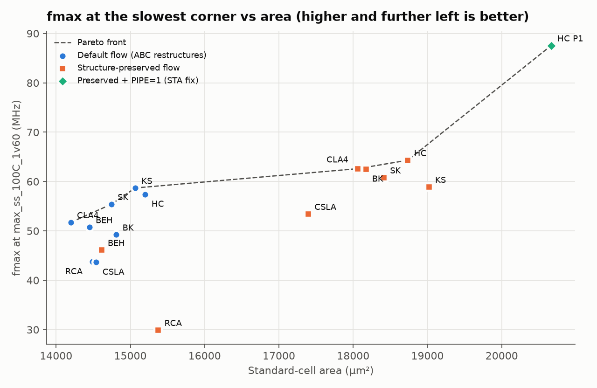
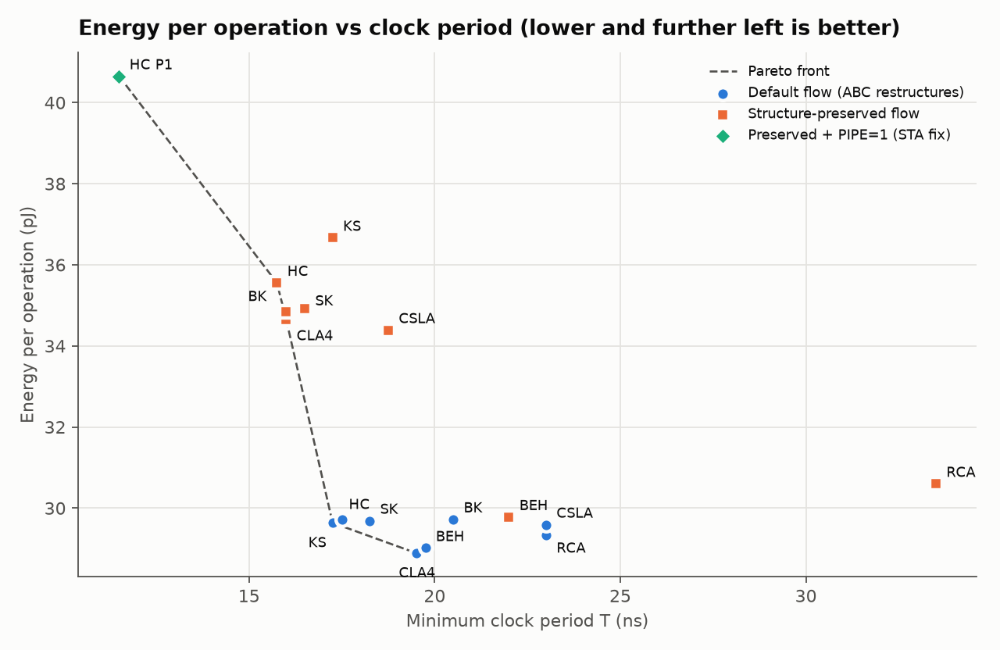
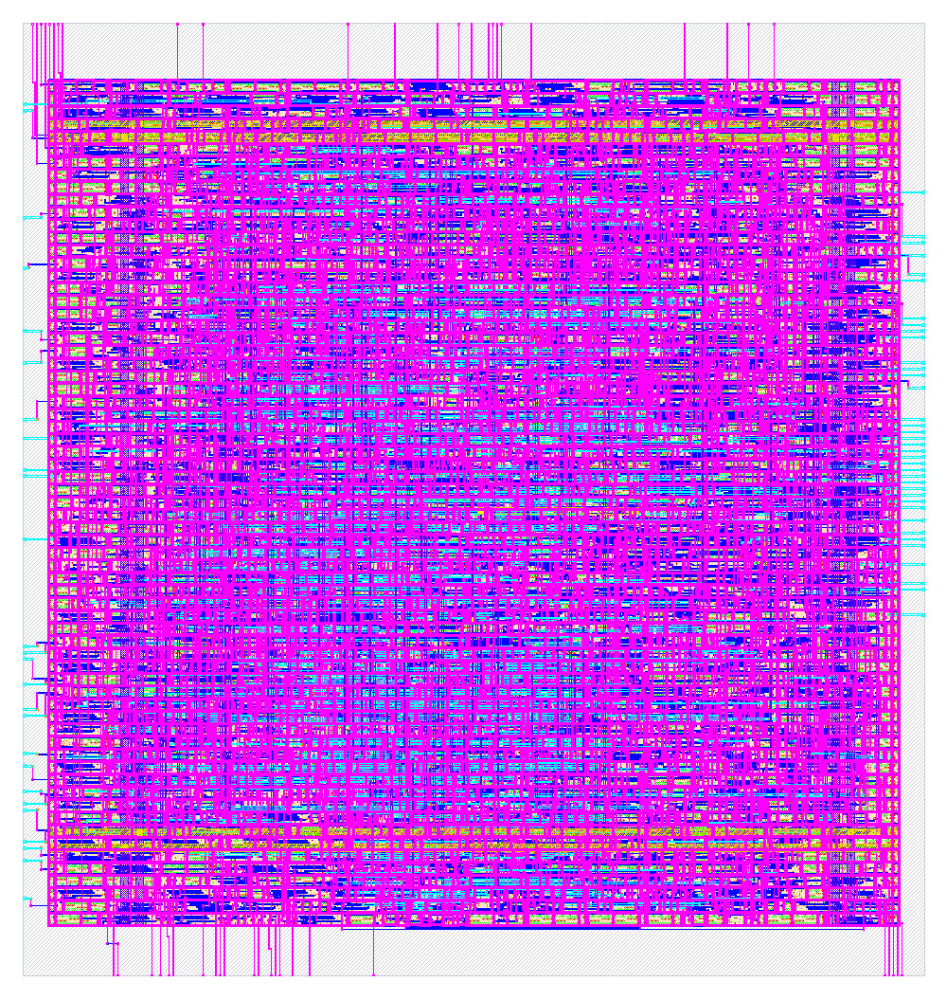
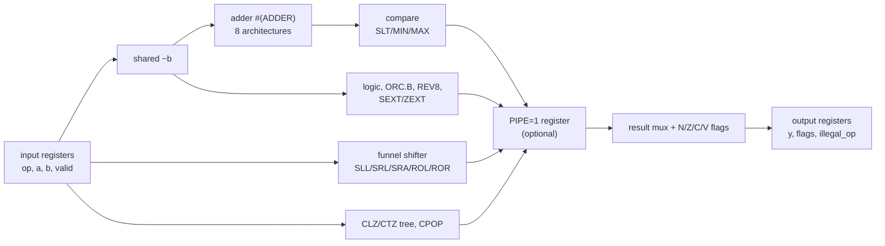

# prefix-adder-alu-sky130

[](https://github.com/vikyathhj-ui/prefix-adder-alu-sky130/actions/workflows/ci.yml)


A 32-bit RV32I + Zbb ALU with a swappable adder, taken from specification to signed-off layout on
SkyWater SKY130 with open-source tools. It asks one question: **which adder should this ALU use at a
given frequency target, and why?** Eight adders are compared: ripple-carry, 4-bit carry-lookahead,
carry-select, Brent–Kung, Kogge–Stone, Sklansky, Han–Carlson, and plain `a + b`. Each one is
verified against a Spike-checked golden model with cocotb and SymbiYosys, then taken through
LibreLane in two flows: the stock flow, whose synthesis turns out to erase the adder architectures,
and a structure-preserving flow. Then each is timed at 9 corners and its power measured from a
gate-level workload simulation.

## Results

<!-- TABLE:BEGIN -->
**Recommended:** HC, preserved flow, 15.75 ns → **64.32 MHz** at the slowest corner, 18735.5 µm² of cells, 35.56 pJ/op; DRC/LVS/antenna clean, worst IR drop 0.49 mV. With PIPE=1 (one more cycle of latency): **87.57 MHz**, 20666.1 µm², 40.65 pJ/op.

**Verified before layout:** 8 adder configurations × 1,000,000 random vectors against the golden model, 100% functional coverage, 26/26 formal proofs.

| Adder | Flow | Min period (ns) | fmax @ ss 100 °C 1.60 V (MHz) | fmax @ tt 25 °C (MHz) | Cell area (µm²) | Energy/op (pJ) | Latency (cycles) |
|---|---|---|---|---|---|---|---|
| **HC** | preserved, PIPE=1 | 11.5 | 87.57 | 165.81 | 20666.1 | 40.65 | 3 |
| **HC** ✅ signoff | preserved | 15.75 | 64.32 | 122.94 | 18735.5 | 35.56 | 2 |
| **CLA4** | preserved | 16.0 | 62.61 | 119.7 | 18059.8 | 34.65 | 2 |
| **BK** | preserved | 16.0 | 62.51 | 120.05 | 18171.2 | 34.85 | 2 |
| **SK** | preserved | 16.5 | 60.81 | 116.61 | 18412.7 | 34.91 | 2 |
| **KS** | default | 17.25 | 58.7 | 112.22 | 15065.7 | 29.64 | 2 |
| **KS** | preserved | 17.25 | 58.91 | 113.36 | 19019.5 | 36.67 | 2 |
| **HC** | default | 17.5 | 57.42 | 110.62 | 15200.8 | 29.72 | 2 |
| **SK** | default | 18.25 | 55.41 | 104.15 | 14745.4 | 29.69 | 2 |
| **CSLA** | preserved | 18.75 | 53.43 | 104.09 | 17395.4 | 34.39 | 2 |
| **CLA4** | default | 19.5 | 51.73 | 98.06 | 14197.4 | 28.89 | 2 |
| **BEH** | default | 19.75 | 50.75 | 96.35 | 14448.9 | 29.02 | 2 |
| **BK** | default | 20.5 | 49.23 | 93.08 | 14810.5 | 29.72 | 2 |
| **BEH** | preserved | 22.0 | 46.13 | 87.45 | 14611.5 | 29.78 | 2 |
| **RCA** | default | 23.0 | 43.75 | 82.75 | 14485.1 | 29.33 | 2 |
| **CSLA** | default | 23.0 | 43.65 | 82.13 | 14541.4 | 29.59 | 2 |
| **RCA** | preserved | 33.5 | 29.9 | 57.68 | 15374.7 | 30.60 | 2 |

Generated by `scripts/gen_readme_table.py` from `results/summary.json`. 17 closing runs on sky130A / `sky130_fd_sc_hd`, sorted by period. Min period: setup WS >= 0 at max_ss_100C_1v60 and hold WS >= 0 at all corners, 0.25 ns steps. Energy/op = power from a gate-level workload VCD × period.
<!-- TABLE:END -->

Full analysis: [`docs/PPA_REPORT.md`](docs/PPA_REPORT.md) (recommendation by target),
[`docs/STA_REPORT.md`](docs/STA_REPORT.md) (critical paths per corner, the PIPE=1 fix), and
[`docs/MICROARCH.md`](docs/MICROARCH.md) (design and adder theory).

| | |
|---|---|
|  |  |



## Block diagram



## What's in here

| Path | What |
|---|---|
| `docs/BRIEF.md` | the project brief this repository implements |
| `docs/SPEC.md` | functional spec: 27 operations, flags, interface timing |
| `model/` | Python golden model, pytest tests, Spike cross-check |
| `rtl/` | SystemVerilog RTL: `alu_top`, shifter, CLZ, CPOP, 8 adders |
| `tb/`, `formal/` | cocotb testbench with functional coverage; SymbiYosys proofs |
| `flow/`, `scripts/` | LibreLane config, sweep, power, signoff, STA and report scripts |
| `results/summary.json` | **the only source of every number in this README and the docs** |
| `docs/DECISIONS.md` | every design and method decision, with evidence |
| `docs/LEARNING.md`, `docs/INTERVIEW.md` | what I learned; interview questions answered with these numbers |
| `docs/AUDIT.md`, `legacy/` | the original project this replaced, and what was wrong with it |

## Reproduce

All tools are in the [IIC-OSIC-TOOLS](https://github.com/iic-jku/IIC-OSIC-TOOLS) Docker image
(LibreLane, OpenROAD, Yosys + slang, Verilator, Icarus, SymbiYosys, Magic, KLayout, Netgen). With the
image running as container `iic-osic`, with this repository cloned under `~/projects/` and mounted at `/foss/projects/prefix-adder-alu-sky130`
and a Python venv in `.venv` (see `CLAUDE.md`):

```bash
docker exec -w /foss/projects/prefix-adder-alu-sky130 iic-osic bash -lc 'make all'
```

`make all` runs lint → model tests → simulation → formal → three LibreLane sweeps → ABC experiment
→ gate-level power → wire delay → signoff → `summary.json` → STA tables, plots, README table and resume
bullets. From scratch, the sweeps take many hours. Finished runs in `runs/` are reused, so a re-run only
re-checks. `make help` lists the individual steps.

## Limitations
- **Simulation and flow only:** no silicon. One PDK (sky130A), one library (`sky130_fd_sc_hd`), one
  run per clock period.
- **Place-and-route noise:** neighbouring periods can close and fail out of order (one case,
  `docs/DECISIONS.md` D-023), so treat differences under about 0.5 ns as ties.
- **Power** comes from zero-delay gate-level simulation of the brief's workload mix, so glitch power
  is not included.
- **Flow settings** (40% utilisation, 20% I/O delay, 12% repair margin) are the same for every run.
  Absolute numbers depend on them.
- **Delay-cell buffering:** the router's repair step uses delay cells as fanout buffers in every run.
  Excluding them is a documented, untested improvement (`docs/STA_REPORT.md`).

## AI assistance

Developed with Claude Code; all results reproduced by Vikyath J with `make all`.

## License

MIT, see [`LICENSE`](LICENSE).
