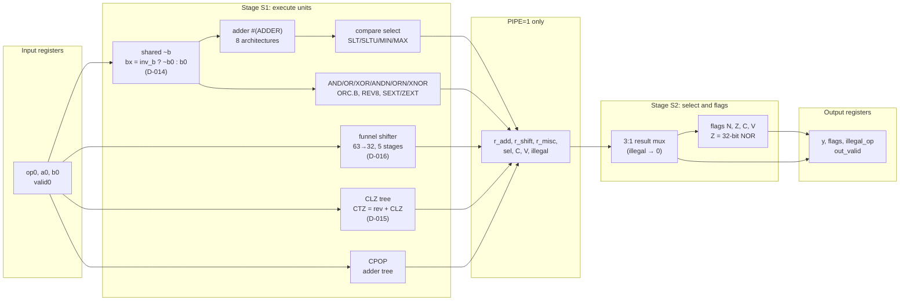

# Micro-architecture

The RV32I + Zbb ALU (`rtl/alu_top.sv`). The functional behaviour is in `docs/SPEC.md`; the reasons
behind each choice are in `docs/DECISIONS.md` (D-0xx below).

## Block diagram

- **Latency** (D-006): 2 cycles with `PIPE=0` (input register → execute → output register), 3 with
  `PIPE=1`. One operation per cycle in both cases.
- **`PIPE=1`** (D-013): registers each unit's *final* result (after the compare select), so the
  3:1 mux and the zero-flag NOR move to their own stage. With `PIPE=0` the box is a wire.

## Resource sharing
- **One adder** serves ADD, SUB, SLT, SLTU, MIN, MAX, MINU and MAXU. Subtraction is `a + ~b + 1`.
- **One `~b` inverter** (D-014) feeds both the adder and the logic unit, so ANDN/ORN/XNOR reuse
  the AND/OR/XOR gates.
- **One shifter** (D-016) does SLL, SRL, SRA, ROL and ROR. It is a 63→32 funnel right shifter whose
  fill bits pick the operation; left shifts reverse the input and output (pure wiring).
- **One CLZ tree** (D-015) does CLZ and CTZ; CTZ reverses the input first.
- Bit reversal and REV8 are wiring only.

## Adder architectures (n = 32)

Selected by the `ADDER` parameter (`rtl/alu_pkg.sv`, codes 0–7). All share one interface
(`a`, `b`, `cin` → `sum`, `cout`). The prefix adders are built from explicit `pg_black` (G, P) and
`pg_gray` (G only) cells in `generate` loops (`rtl/adders/`).

**Theory** (standard textbook values for n = 32; prefix levels only, without the p/g pre-processing
and the final sum XOR):

| Arch | Carry structure | Carry levels | Max fan-out | Wire tracks | Prefix cells |
|---|---|---|---|---|---|
| RCA | ripple chain | 32 | 2 | 1 | 32 full adders |
| CLA4 | 4-bit lookahead units, 3 levels (8 → 2 → 1 units) | 2 × 3 (up and down) | 4 | short | 11 units |
| CSLA | 8-bit RCA blocks, each upper block duplicated for cin = 0/1 | 8 + 3 muxes | 9 (block select) | 1 | 7 × 8-bit RCAs |
| BK (Brent–Kung) | sparse tree, up-sweep and down-sweep | 2 log₂n − 1 = 9 | 2 | 1 | 2n − 2 − log₂n = 57 |
| KS (Kogge–Stone) | full tree, every bit at every level | log₂n = 5 | 2 | n/2 = 16 | n log₂n − n + 1 = 129 |
| SK (Sklansky) | divide and conquer | log₂n = 5 | n/2 = 16 | 1 | (n/2) log₂n = 80 |
| HC (Han–Carlson) | KS on odd bits plus one extra level | log₂n + 1 = 6 | 2 | n/4 = 8 | (n/2) log₂n = 80 |
| BEH | `a + b`, left to the synthesiser | (tool's choice) | — | — | — |

- **Why prefix adders are log-depth:** the carry into bit i is the prefix "sum" of (g, p) pairs from
  bit 0 to i under an *associative* operator, (G, P)ᵢ ∘ (G, P)ⱼ = (Gᵢ + PᵢGⱼ, PᵢPⱼ).
  Associativity means the n-input prefix can be computed as a tree instead of a chain:
  log₂n levels instead of n.
- **The trade-off triangle** (Harris): a prefix tree can minimise levels, fan-out or wire tracks, but
  not all three at once.
  - KS minimises levels and fan-out, and pays in wires: at level k each bit reaches 2ᵏ positions
    back, so long, parallel wire runs.
  - SK minimises levels and wires, and pays in fan-out: one node drives up to n/2 bits.
  - BK minimises wires and cells, and pays in levels.
  - HC sits between KS and BK: one extra level halves KS's wiring.

**Measured depth** (synthesis only, adder alone between registers, tt corner; D-026, from
`results/flow/abc_experiment.json`): with the structure kept, logic depth on the worst
register-to-register path is RCA 32, CLA4 15, CSLA 11, BK 10, KS 6, SK 7, HC 7, BEH 20, in the
order theory predicts. LibreLane's default synthesis rebuilt every prefix adder into a 16–22-deep
chain. That is why the project runs two flows (D-027).

**After layout**, the ranking changes again, because wires and fan-out now cost delay. See
`docs/PPA_REPORT.md` and `docs/STA_REPORT.md`.

## Other units
- **Shifter** (D-016): five 2:1 mux stages (shift by 16, 8, 4, 2, 1), each only as wide as the
  later stages can use (63 → 47 → 39 → 35 → 33 → 32 bits). The shift amount is `b[4:0]`;
  `b[31:5]` is ignored.
- **CLZ/CTZ** (D-015): a recursive halving tree (`rtl/clz_tree.sv`), 5 mux levels. All-zero gives
  32.
- **CPOP:** an adder tree (`rtl/cpop.sv`). The count is 0–32, so it needs 6 bits.
- **Flags:** N = y[31]; Z = (y == 0), a 32-input NOR; C and V come from the adder for ADD and SUB
  (SUB: C = no borrow, D-008) and are 0 for every other op (SPEC section 4).
- **Illegal opcodes** 27–31: y = 0, flags = 0100 (Z), `illegal_op` = 1.
