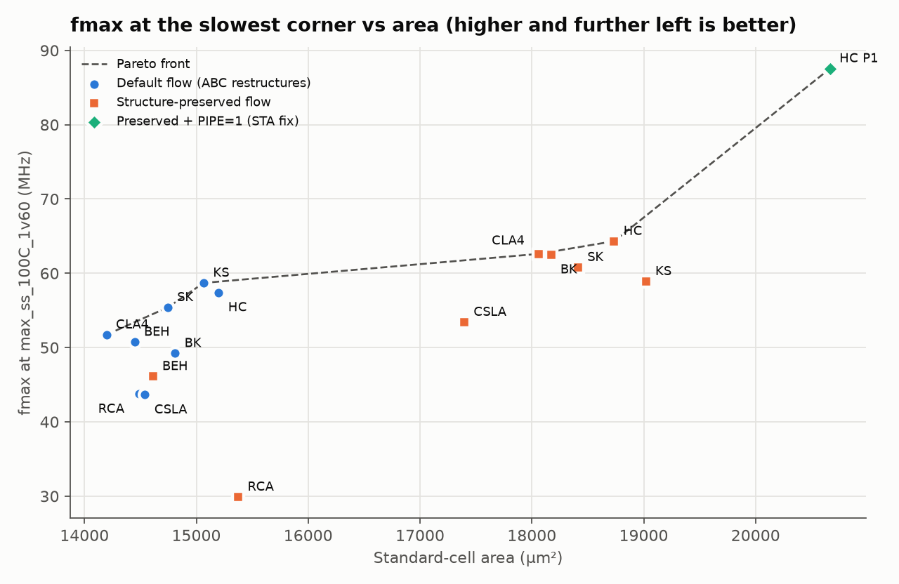
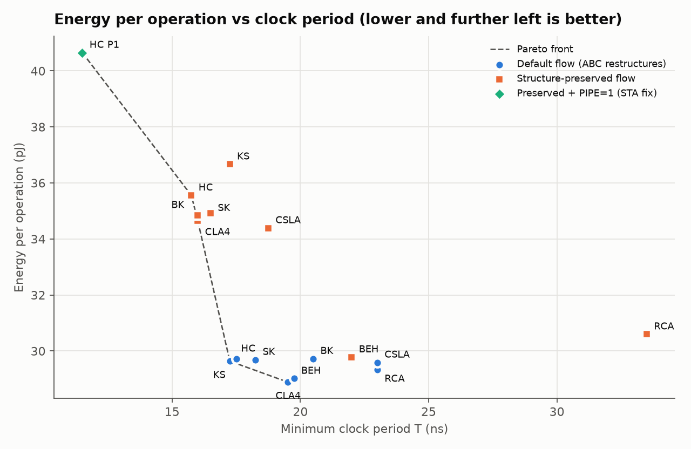
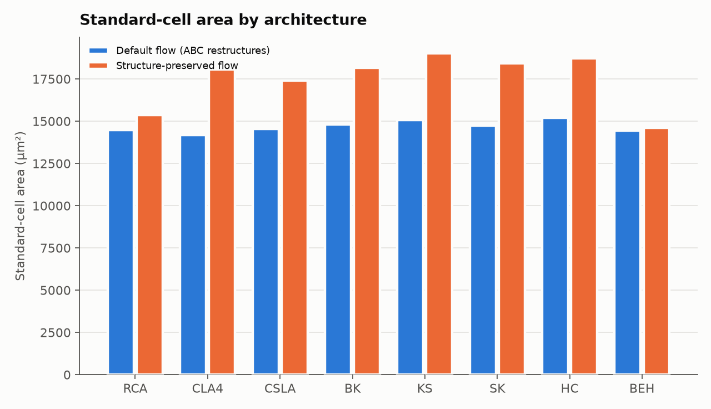

# PPA report — adder architectures for an RV32I + Zbb ALU on SKY130

**Question** (BRIEF): which adder should this ALU use at a given frequency target, and why?

**Short answer** (section 6): below about 59 MHz at the slow corner, use the stock flow with the
smallest design that meets the target (CLA4, SK or KS). For 59–64 MHz you need Han–Carlson with its
prefix structure preserved; that is the signed-off design. Above that, pipeline it (PIPE=1, up to
87.57 MHz). Every number below comes from `results/summary.json`, and every table is printed by a
script (`scripts/phase4_tables.py`, or a snippet that reads `summary.json`).

## 1. Method
- **Design:** `rtl/alu_top.sv`, 27 operations, 2-cycle latency (3 with PIPE=1), one shared adder chosen
  by the `ADDER` parameter (`docs/MICROARCH.md`). All 8 adders were verified with 1M random vectors
  each, 100% functional coverage and formal equivalence before layout (Phase 3).
- **Flow:** LibreLane on sky130A, `sky130_fd_sc_hd`, with the same settings for every run:
  - fixed 40% core utilisation and 50% placement density (D-022);
  - timing repair after global routing (D-028);
  - a setup-repair margin of 12% of the period (D-029).
- **Two flows** (D-026, D-027):
  - **default:** LibreLane's stock synthesis, which flattens the design and lets ABC restructure it;
  - **preserved:** `keep_hierarchy` on the prefix and lookahead cells, so each architecture survives
    synthesis.
- **Minimum period** (D-023): the lowest period at 0.25 ns steps with setup slack ≥ 0 at
  `max_ss_100C_1v60` (the slowest of 9 corners), hold slack ≥ 0 at all 9 corners, and the next period
  up also closing.
- **Power** (D-025): each closing netlist runs 10,000 operations of the brief's mix (50% add/sub, 20%
  logic, 20% shift, 10% Zbb) in gate-level simulation at its own clock. OpenSTA turns the VCD into
  power. Energy/op = P × T.
- **Noise:** place-and-route is not monotonic. KS (preserved) closed at 16.25 ns, failed at 16.5, and
  closed again at 16.75. **Treat differences under about 0.5 ns as ties**: CLA4 and BK (preserved),
  both 16.0 ns, are tied, and so are KS and HC in the default flow (17.25 and 17.5 ns).

## 2. Results

**preserved** (from `results/summary.json`)

| Arch | Min T (ns) | Fails at (ns) | fmax max_ss (MHz) | fmax nom_tt (MHz) | Std cells | Cell area (µm²) | Die (µm²) | Power (mW) | Energy/op (pJ) |
|---|---|---|---|---|---|---|---|---|---|
| RCA | 33.5 | 33.25 | 29.9 | 57.68 | 2037 | 15374.7 | 33595.8 | 0.913 | 30.60 |
| CLA4 | 16.0 | 15.75 | 62.61 | 119.7 | 2427 | 18059.8 | 39280.3 | 2.166 | 34.65 |
| CSLA | 18.75 | 18.5 | 53.43 | 104.09 | 2286 | 17395.4 | 37655.8 | 1.834 | 34.39 |
| BK | 16.0 | 15.75 | 62.51 | 120.05 | 2463 | 18171.2 | 39147.6 | 2.178 | 34.85 |
| KS | 17.25 | 17.0 | 58.91 | 113.36 | 2635 | 19019.5 | 41844.7 | 2.126 | 36.67 |
| SK | 16.5 | 16.25 | 60.81 | 116.61 | 2534 | 18412.7 | 40009.3 | 2.116 | 34.91 |
| HC | 15.75 | 15.5 | 64.32 | 122.94 | 2567 | 18735.5 | 40009.3 | 2.258 | 35.56 |
| BEH | 22.0 | 21.75 | 46.13 | 87.45 | 2132 | 14611.5 | 32249.0 | 1.354 | 29.78 |

**default** (from `results/summary.json`)

| Arch | Min T (ns) | Fails at (ns) | fmax max_ss (MHz) | fmax nom_tt (MHz) | Std cells | Cell area (µm²) | Die (µm²) | Power (mW) | Energy/op (pJ) |
|---|---|---|---|---|---|---|---|---|---|
| RCA | 23.0 | 22.75 | 43.75 | 82.75 | 2066 | 14485.1 | 31987.2 | 1.275 | 29.33 |
| CLA4 | 19.5 | 19.25 | 51.73 | 98.06 | 2024 | 14197.4 | 31824.6 | 1.482 | 28.89 |
| CSLA | 23.0 | 22.75 | 43.65 | 82.13 | 2080 | 14541.4 | 32293.9 | 1.287 | 29.59 |
| BK | 20.5 | 20.25 | 49.23 | 93.08 | 2096 | 14810.5 | 32166.4 | 1.450 | 29.72 |
| KS | 17.25 | 17.0 | 58.7 | 112.22 | 2140 | 15065.7 | 32810.1 | 1.718 | 29.64 |
| SK | 18.25 | 18.0 | 55.41 | 104.15 | 2101 | 14745.4 | 32238.2 | 1.627 | 29.69 |
| HC | 17.5 | 17.25 | 57.42 | 110.62 | 2134 | 15200.8 | 32582.2 | 1.698 | 29.72 |
| BEH | 19.75 | 19.5 | 50.75 | 96.35 | 2040 | 14448.9 | 32351.5 | 1.469 | 29.02 |

**preserved_P1** (from `results/summary.json`)

| Arch | Min T (ns) | Fails at (ns) | fmax max_ss (MHz) | fmax nom_tt (MHz) | Std cells | Cell area (µm²) | Die (µm²) | Power (mW) | Energy/op (pJ) |
|---|---|---|---|---|---|---|---|---|---|
| HC | 11.5 | 11.25 | 87.57 | 165.81 | 2703 | 20666.1 | 45835.8 | 3.535 | 40.65 |

## 3. ABC finding: the stock flow erases the architectures (D-026)

The adder alone between registers, synthesised with the sweep's exact settings, then timed with
OpenSTA (tt corner, no wires):

| Arch | Default: logic depth | Default: r2r delay (ns) | Default: area (µm²) | Preserved: logic depth | Preserved: r2r delay (ns) | Preserved: area (µm²) |
|---|---|---|---|---|---|---|
| RCA | 32 | 12.7865 | 2842.7 | 32 | 12.7865 | 2842.7 |
| CLA4 | 22 | 6.1088 | 3009.1 | 15 | 2.6773 | 3803.6 |
| CSLA | 32 | 12.7865 | 2842.7 | 11 | 5.1996 | 3827.4 |
| BK | 20 | 6.2303 | 2969.1 | 10 | 2.5135 | 3316.9 |
| KS | 17 | 4.5047 | 3088.0 | 6 | 1.7392 | 4307.9 |
| SK | 21 | 6.0724 | 2996.6 | 7 | 2.0776 | 3633.5 |
| HC | 16 | 4.4413 | 3066.7 | 7 | 1.9001 | 3633.5 |
| BEH | 20 | 5.9127 | 2979.1 | 20 | 5.9134 | 2979.1 |

- **Default synthesis** rebuilds every prefix adder into a 16–22-deep chain. KS goes from depth 6
  to 17. CSLA becomes identical to RCA: same cells, same 12.7865 ns.
- **This is why** the default-flow results sit within 17.25–23.0 ns and 28.89–29.72 pJ/op: they
  measure what ABC built, not the architectures. **The architectural differences did not survive
  default synthesis.** They do survive with `keep_hierarchy`, and the preserved flow then separates
  RCA (33.5 ns) from the prefix adders (15.75–17.25 ns), as theory predicts.

## 4. Why layout changes the ranking (D-024)

**Preserved flow:**

**preserved**

| Arch | Critical path at max_ss: logic cells / all cells | Post-synth delay (ns) | Post-route delay (ns) | Change | Same netlist, ideal wires (ns) | Wire delay (ns) | Repair-buffer area (µm²) | Wirelength (µm) |
|---|---|---|---|---|---|---|---|---|
| RCA | 41 / 54 | 44.298 | 33.1149 | -25.2% | 30.6088 | 2.5061 (7.6%) | 2836.5 | 54248 |
| CLA4 | 13 / 27 | 24.7099 | 15.5443 | -37.1% | 13.0876 | 2.4567 (15.8%) | 3384.5 | 72709 |
| CSLA | 26 / 38 | 24.3135 | 18.3359 | -24.6% | 16.5697 | 1.7662 (9.6%) | 3316.9 | 62542 |
| BK | 12 / 20 | 25.0274 | 15.6146 | -37.6% | 13.5028 | 2.1118 (13.5%) | 3504.6 | 70496 |
| KS | 16 / 24 | 22.3333 | 16.6334 | -25.5% | 14.087 | 2.5464 (15.3%) | 3348.2 | 80258 |
| SK | 13 / 23 | 23.0369 | 16.121 | -30.0% | 13.8112 | 2.3098 (14.3%) | 3494.6 | 72344 |
| HC | 12 / 21 | 22.57 | 15.2254 | -32.5% | 13.3634 | 1.862 (12.2%) | 3616.0 | 74179 |
| BEH | 29 / 57 | 22.5566 | 21.2554 | -5.8% | 18.5064 | 2.7491 (12.9%) | 2673.8 | 52950 |

- **Post-synthesis vs post-route, measured as the brief asks:** post-route is *faster* in every run,
  because the synthesised netlist is unsized and the resizer then upsizes and buffers the critical
  path.
- **The wire cost alone:** the same final netlist timed with and without its extracted RC. Wires add
  1.86–2.55 ns (12.2–15.8%) to the prefix adders' critical paths. RCA has the lowest share (7.6%): a
  chain of short, local hops.
- **KS vs BK:** KS has the shallowest tree (depth 6 before layout against BK's 10) but n/2 = 16 wire
  tracks and about twice the cells. After layout it is the largest design (2635 cells, 80,258 µm of
  wire), and it closes at 17.25 ns against BK's 16.0. BK's extra levels cost less than KS's wires at
  32 bits in sky130.
- **HC**, which halves KS's wiring for one extra level, is the fastest at 15.75 ns.
- **But the adder is not the critical path in the fast designs.** In HC (preserved), the worst path at
  `max_ss` runs from the shift amount through the shifter and result mux into the 32-input zero-flag
  detector (`docs/STA_REPORT.md`). HC, CLA4, BK and SK (15.75–16.5 ns) are all limited by that shared
  non-adder logic. Their real adder differences are hidden, which is why PIPE=1 helps so much.

**Default flow** (for comparison):

**default**

| Arch | Critical path at max_ss: logic cells / all cells | Post-synth delay (ns) | Post-route delay (ns) | Change | Same netlist, ideal wires (ns) | Wire delay (ns) | Repair-buffer area (µm²) | Wirelength (µm) |
|---|---|---|---|---|---|---|---|---|
| RCA | 36 / 52 | 28.4051 | 22.4682 | -20.9% | 19.5545 | 2.9137 (13.0%) | 2596.2 | 50457 |
| CLA4 | 22 / 43 | 27.1581 | 19.035 | -29.9% | 17.3173 | 1.7177 (9.0%) | 2423.6 | 49931 |
| CSLA | 34 / 46 | 28.2384 | 22.5678 | -20.1% | 20.443 | 2.1248 (9.4%) | 2552.4 | 52340 |
| BK | 26 / 54 | 21.5171 | 19.9768 | -7.2% | 17.5449 | 2.4319 (12.2%) | 2900.3 | 51552 |
| KS | 24 / 46 | 18.7776 | 16.7444 | -10.8% | 14.4407 | 2.3037 (13.8%) | 2835.2 | 52261 |
| SK | 23 / 47 | 20.7076 | 17.7181 | -14.4% | 15.8023 | 1.9158 (10.8%) | 2725.1 | 50748 |
| HC | 18 / 36 | 19.9204 | 17.1091 | -14.1% | 15.1106 | 1.9985 (11.7%) | 2930.3 | 51874 |
| BEH | 30 / 55 | 20.8434 | 19.3958 | -6.9% | 17.2385 | 2.1574 (11.1%) | 2527.4 | 50773 |

## 5. Power and energy
- **Default flow:** 28.89–29.72 pJ/op, nearly flat, because ABC made the adders alike.
- **Preserved flow:** the prefix and lookahead adders cost 34.65–36.67 pJ/op against 30.60 for RCA.
  More cells and more wire capacitance switch on every addition. KS is the highest (36.67 pJ/op).
- **Energy, not power, is the fair comparison:** RCA (preserved) draws 0.913 mW and HC 2.258 mW, but
  per operation the gap is 30.60 vs 35.56 pJ, because HC finishes each operation in less than half
  the time.
- **PIPE=1** costs 40.65 pJ/op: about 100 more flops switch every cycle.
- **Limitation:** zero-delay gate-level simulation has no glitches. Glitch power is missing, most of
  all for long ripple chains (RCA).

## 6. Recommendation

The Pareto points (fmax at the slow corner vs cell area), cheapest first:

| Target at max_ss | Use | Min period (ns) | Cell area (µm²) | Energy/op (pJ) | Why |
|---|---|---|---|---|---|
| up to 51.73 MHz | **CLA4**, default flow | 19.5 | 14197.4 | 28.89 | smallest cell area and lowest energy/op of all 17 runs |
| up to 55.41 MHz | **SK**, default flow | 18.25 | 14745.4 | 29.69 | next point on the fmax-vs-area front |
| up to 58.7 MHz | **KS**, default flow | 17.25 | 15065.7 | 29.64 | fastest design the stock flow produces |
| up to 64.32 MHz | **HC**, preserved flow | 15.75 | 18735.5 | 35.56 | fastest single-cycle-execute design; **signed off** (D-031) |
| up to 87.57 MHz | **HC**, preserved, PIPE=1 flow | 11.5 | 20666.1 | 40.65 | PIPE=1: latency 3 instead of 2 (D-032) |

- **Signed-off configuration** (D-031): **HC, preserved flow, PIPE=0, 15.75 ns.** DRC, LVS and
  antenna are clean, and IR drop measured with the workload VCD is 0.491 mV
  (`results/signoff/HC_preserved/`).
- **Two cheaper designs from the stock flow** are not on the fmax-vs-area front, but are good
  enough:
  - **BEH** (`a + b`): 50.75 MHz at 14,448.9 µm² and 29.02 pJ/op. Writing nothing is a real option
    at low targets.
  - **RCA:** 43.75 MHz. ABC turns it into a fast adder anyway.
- **Never the best choice here:**
  - CSLA: duplicated hardware, and in the stock flow it is identical to RCA;
  - KS, preserved: the most area and energy, slower than HC and BK;
  - RCA, preserved: 33.5 ns.
- **For a CPU:** the brief's ALU sits in a 2-cycle pipeline slot. If one extra cycle of latency is
  acceptable, PIPE=1 gives 36% more clock for 10% more cell area. If not, HC PIPE=0 is the fastest
  option.

## 7. Limitations
- **Simulation and flow only.** No silicon, one PDK, one standard-cell library, one seed per period.
- **Run-to-run noise** of about 0.5 ns between neighbouring periods (section 1).
- **Results depend on the flow settings.** The fixed 40% utilisation, the 20% I/O delay and the 12%
  repair margin are the same for every run, but other settings would give other absolute numbers.
- **The delay-cell buffering** found in STA (D-032) affects every run alike. Removing it is the next
  experiment, and could change absolute periods.
- **Glitch power** is not included (section 5).
